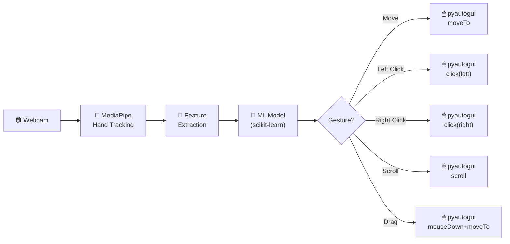

<p align="center">
  <h1 align="center">🖱 AI Virtual Mouse</h1>
  <p align="center">
    Control your computer with hand gestures — no hardware mouse required.
  </p>
</p>

<p align="center">
  
  
  
  
  
</p>

---

## ✨ Overview

**AI Virtual Mouse** uses a webcam to track your hand in real-time, classify your gesture with a trained machine-learning model, and translate it into desktop mouse actions — **move**, **click**, **scroll**, and **drag** — all hands-free.

The project features a sleek dark-themed GUI with an embedded live camera preview, real-time FPS/action status, and configurable sensitivity sliders.

---

## 🚀 Features

| Feature | Description |
|---------|-------------|
| 🖐 **5 Gesture Actions** | Move, Left Click, Right Click, Scroll, and Drag |
| 📷 **Live Camera Preview** | Embedded in the GUI — no separate OpenCV window |
| ⚡ **Real-Time Inference** | ~30 FPS gesture classification with ML model |
| 🎛 **Configurable Settings** | Smoothening, scroll deadzone, and scroll speed sliders |
| 🎨 **Premium Dark UI** | Modern dashboard built with CustomTkinter |
| 🧠 **Custom ML Model** | Trained on normalised hand-landmark features |
| 📊 **Data Pipeline** | Includes data collection and training notebooks |

---

## 🏗 Architecture



---

## 📁 Project Structure

```
Virtual Mouse/
├── Agent_Execution/
│   ├── App_GUI.py              # Premium dark-themed control panel
│   └── Main.py                 # VirtualMouseController class
├── Data_Engineering/
│   ├── Dataset/
│   │   ├── Collect_Data.py     # Capture hand-landmark data with labels
│   │   └── virtual_mouse_data.csv
│   └── data_cleaning.ipynb     # Preprocessing & exploratory analysis
├── Model_Training/
│   ├── Train_Model.ipynb       # Model training notebook
│   └── virtual_mouse_brain.pkl # Trained gesture classifier
├── Utils/
│   ├── HandTrackingModule.py   # MediaPipe hand-detection wrapper
│   └── hand_landmarker.task    # MediaPipe model asset
├── requirements.txt
├── .gitignore
└── README.md
```

---

## ⚡ Quick Start

### Prerequisites

- Python **3.10+**
- A working **webcam**
- Windows / macOS / Linux

### Installation

```bash
# 1. Clone the repository
git clone https://github.com/HAITHM-ALAKHALI/virtual_mouse.git
cd virtual_mouse

# 2. Create a virtual environment (recommended)
python -m venv venv
venv\Scripts\activate        # Windows
# source venv/bin/activate   # macOS / Linux

# 3. Install dependencies
pip install -r requirements.txt
```

### Run

```bash
cd Agent_Execution
python App_GUI.py
```

The GUI launches → click **▶ Start Virtual Mouse** → show your hand to the camera!

---

## 🤚 Gesture Reference

| Gesture | Hand Pose | Action |
|---------|-----------|--------|
| ☝️ **Move** | Index finger extended, others folded | Cursor follows index fingertip |
| ✌️ **Left Click** | Index + Middle fingers together | Single left-click |
| 🤟 **Right Click** | Index + Middle + Ring fingers up | Single right-click |
| 🖐️ **Scroll** | Open palm flat | Scroll up/down based on hand position |
| ✊ **Drag** | Closed fist | Click-and-drag; release when hand opens |

---

## ⚙️ Configuration

All settings are adjustable live from the GUI:

| Setting | Range | Default | Description |
|---------|-------|---------|-------------|
| **Smoothening** | 1 – 15 | 7 | Higher = smoother but slower cursor movement |
| **Scroll Deadzone** | 20 – 150 | 60 | Pixel buffer around centre; avoids accidental scrolling |
| **Scroll Speed** | 10 – 150 | 50 | Lines scrolled per frame when hand is outside the deadzone |

---

## 🛠 Tech Stack

| Technology | Purpose |
|-----------|---------|
| [MediaPipe](https://mediapipe.dev/) | Hand landmark detection |
| [scikit-learn](https://scikit-learn.org/) | Gesture classification model |
| [OpenCV](https://opencv.org/) | Camera capture & image processing |
| [pyautogui](https://pyautogui.readthedocs.io/) | Desktop mouse automation |
| [CustomTkinter](https://customtkinter.tomschimansky.com/) | Modern GUI framework |
| [Pillow](https://python-pillow.org/) | Image format conversion for GUI preview |

---

## 🧑‍💻 Developer

<table>
  <tr>
    <td><strong>Haithm Al-Akhali</strong></td>
  </tr>
  <tr>
    <td>
      <a href="https://haithm-al-akhali.vercel.app/">🌐 Portfolio</a> ·
      <a href="https://github.com/HAITHM-ALAKHALI">💻 GitHub</a>
    </td>
  </tr>
</table>

---

## 📄 License

This project is licensed under the **MIT License** — see the [LICENSE](LICENSE) file for details.